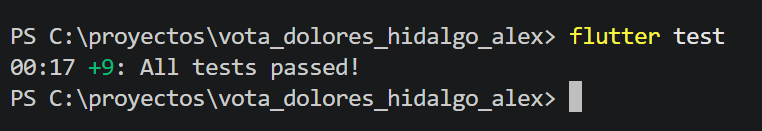
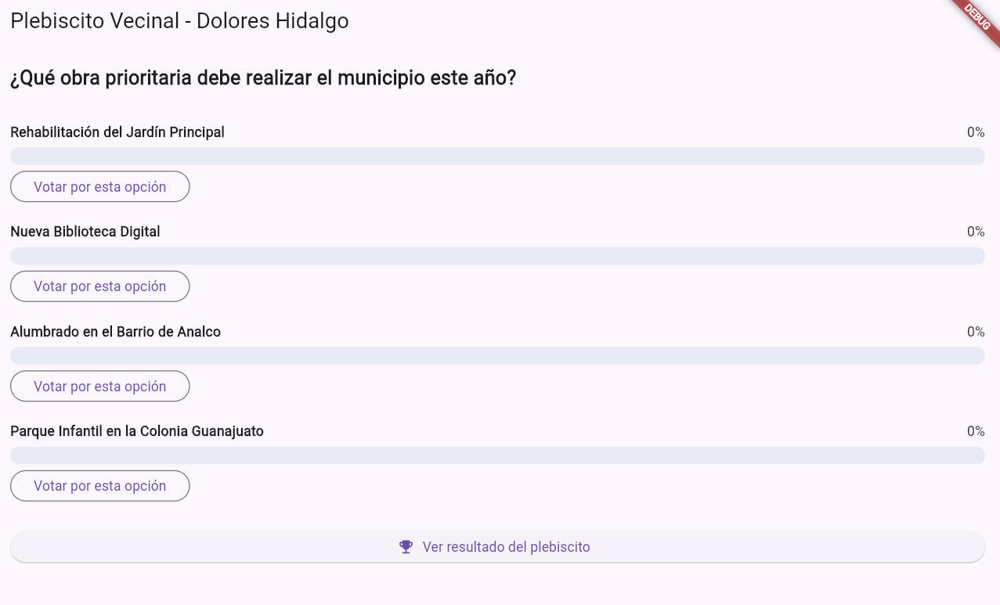
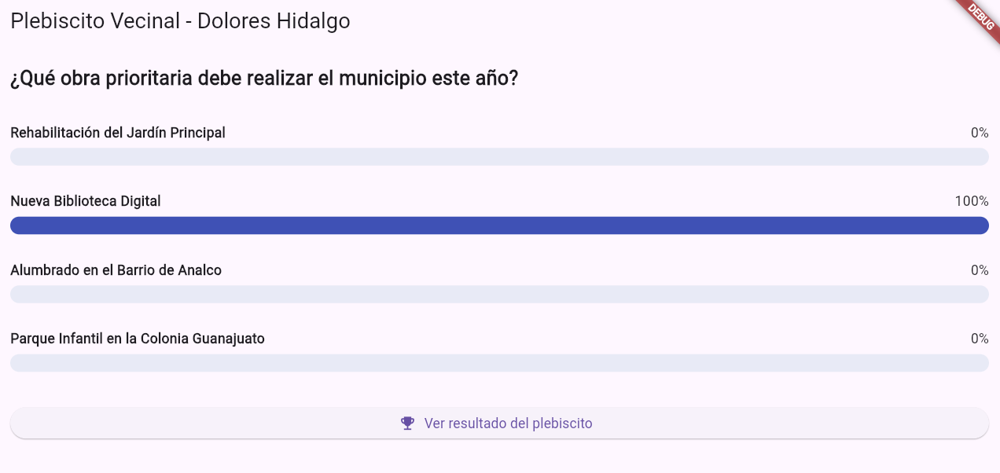
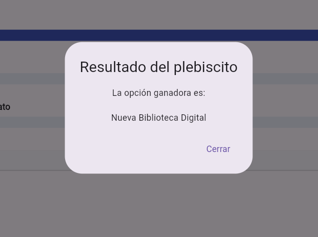

# 🗳️ Vota Dolores Hidalgo — Práctica TDD

¡Hola! Este repositorio contiene la solución a la práctica **"Vota Dolores Hidalgo"**, un plebiscito vecinal interactivo desarrollado con Flutter y construido 100% siguiendo la metodología **TDD (Test-Driven Development)**.

---

## 🎯 ¿Qué hace esta aplicación?

Permite a los vecinos votar por una obra comunitaria para el municipio. La lógica de negocio está totalmente blindada mediante pruebas unitarias para garantizar que:
* Cada usuario solo pueda votar **una sola vez**.
* No se pueda votar por opciones inválidas o si la votación ya cerró.
* Los porcentajes se calculen correctamente sin errores de división entre cero.
* Se detecten empates de forma justa.

---

## 🧪 Evidencias de Pruebas Unitarias (TDD)

Ejecutamos la suite completa con `flutter test` y las 9 pruebas (8 rondas + 1 de integración) pasaron en verde:



---

## 📸 Evidencias de la Interfaz y Funcionamiento

A continuación se muestran las capturas del funcionamiento de la app con sus gráficas animadas:

| Inicio / Encuesta | Voto Registrado y Animación | Revelación del Ganador |
| :---: | :---: | :---: |
|  |  |  |

---

## 🛠️ Estructura del Proyecto

* **`lib/modelos/`**: Modelos de datos base (`Votacion`, `OpcionVotacion`, etc.).
* **`lib/logica/`**: Reglas de negocio y servicio de votación (código Dart puro).
* **`lib/presentation/`**: Pantalla de la app con animaciones (`TweenAnimationBuilder`).
* **`test/`**: Pruebas unitarias paso a paso.

---

## 🚀 Pasos para probarlo localmente

1. Clona el repositorio:
   ```bash
   git clone [https://github.com/TU_USUARIO/vota-dolores-hidalgo.git](https://github.com/TU_USUARIO/vota-dolores-hidalgo.git)